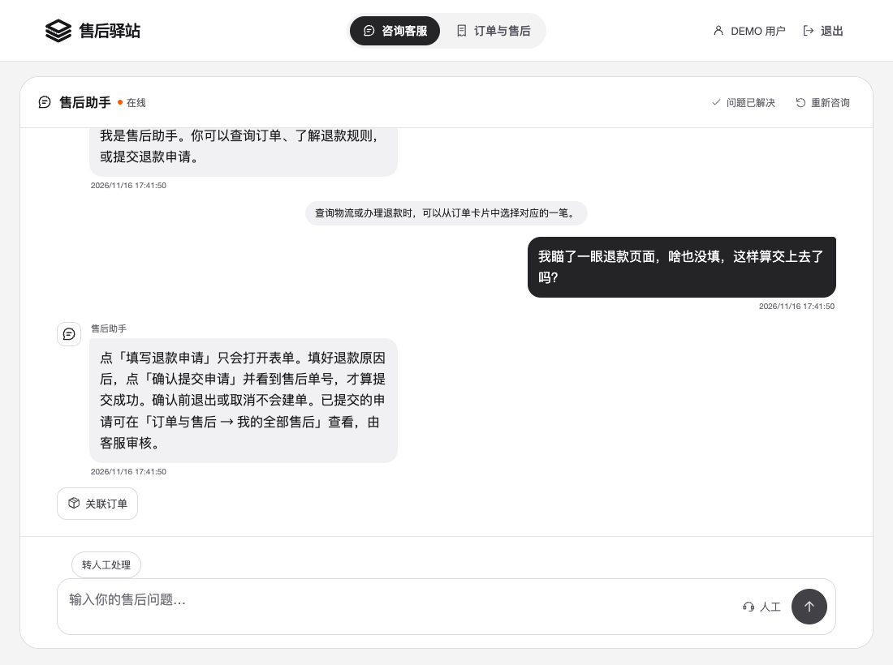
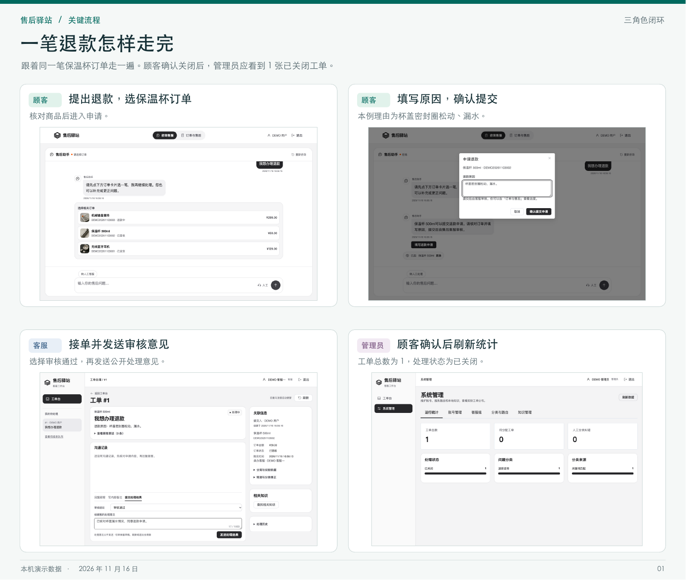

# 演示与复验

从[首页](../README.md)安装并启动。再次演示时只需执行启动命令，终端按 Ctrl+C 可结束服务。默认端口为 8765，如已占用，可在启动命令末尾加 `--port 8766`。

## 怎样看顾客的退款进度

选中自己的演示订单后，顾客可以先问到账时效或操作步骤。点击「填写退款申请」只打开表单，输入原因后可以取消。点击「确认提交申请」后，应在「订单与售后 → 我的全部售后」看到单号。客服给出审核意见后，顾客可以确认结束，也可以补充问题让客服继续处理原单。付款与银行到账不在本机演示范围内。





## 复验

从仓库根目录运行以下命令。测试和浏览器回放使用隔离的演示库。

```sh
sh scripts/check.sh
backend/.venv/bin/python scripts/check_self_built_zh.py --cases data/review/self_built_zh/service_zh_v2.json --output .cache/zh-coverage.json
backend/.venv/bin/python scripts/check_portals.py --suite service-fresh --case-set r25-submit
backend/.venv/bin/python scripts/check_portals.py --suite service-cycle
```

中文场景集含 140 个自建工程用例，覆盖政策、意愿、时效、物流和转人工等分支。默认服务在本机按规则和会话状态处理请求，无需 API Key。首次安装依赖需要联网。
